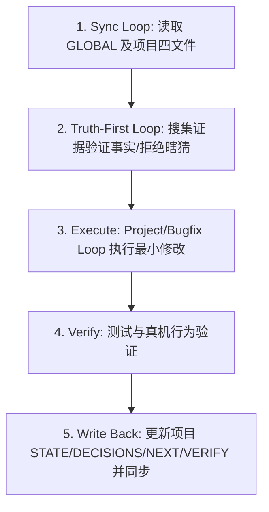

# Codex & Claude Global Sync Configuration (GLOBAL.md)

本文件作为跨机协作与状态对齐的全局枢纽，存储在 iCloud 共享目录中。任何工具（Codex、Claude Code、Cursor 等）在启动时都必须先读取此文件。

---

## 一、双机同步分工 (Sync Layer Split)

### 1. 账户层 (Account Layer)
*不强行由脚本同步，通过平台原生同步或登录态继承*
- **Custom Instructions**：包含当前系统的三层协作框架。
- **System Memory**：包含个人偏好与长期运行习惯。

### 2. iCloud 共享层 (iCloud Shared Layer)
*所有运行工具必须能读取并同步写入此目录*
- **[GLOBAL.md](file:///Users/ethan/Library/Mobile%20Documents/com~apple~CloudDocs/Downloads/LLM%20wiki/GLOBAL.md)**：本文件，定义全局同步习惯。
- **项目状态文件**：每个项目的 `.memory/` 下必须拥有：
  - `STATE.md`：追踪当前开发所处阶段（Idea/MVP/Launch/Scale）与核心进展。
  - `DECISIONS.md`：记录过程中的关键架构与设计判断。
  - `NEXT.md`：指定下一轮迭代的唯一且具体的执行动作。
  - `VERIFY.md`：记录每轮修改的验证结果和测试指令。

### 3. 本机层 (Local Environment Layer)
*仅存在于当前运行机器，不可同步*
- 本地终端权限、依赖缓存、本地临时编译及运行状态。

---

## 二、标准执行循环 (The Master Sequence)

任何任务必须严格遵循以下执行路径，并在每一步输出验证结论：

### 最短路径口诀
`sync -> truth -> execute -> verify -> write back`
（先同步 -> 验事实 -> 最小执行 -> 跑测试 -> 写回状态）
