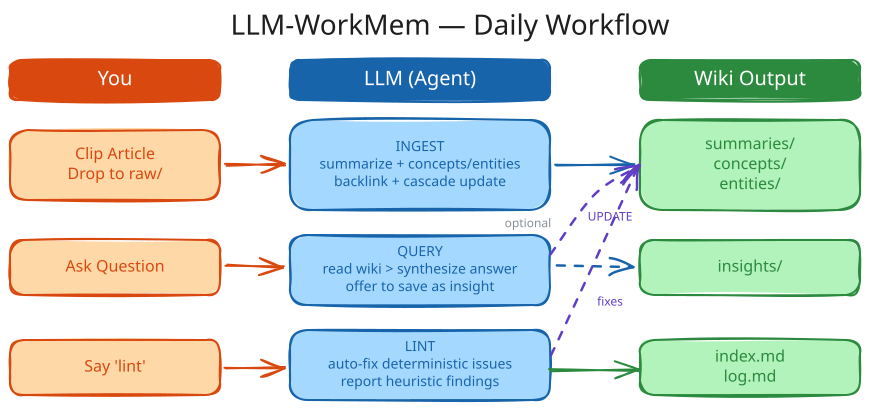

# llm-workmem

<p align="center">
  <br />
  <sub>Universal Cross-Agent Working Memory & Knowledge Platform</sub>
</p>

[](LICENSE)
[](pyproject.toml)

An LLM working memory and knowledge platform that evolves with you. Originating from [Karpathy's LLM-WorkMem](https://gist.github.com/karpathy/442a6bf555914893e9891c11519de94f), `llm-workmem` has evolved into a comprehensive **cross-agent working memory, task handoff, and evidence federation engine** designed for modern AI coding workflows.

[简体中文文档](README.zh-CN.md)

---

## Overview

Modern software engineering frequently spans multiple AI tools: you might brainstorm or plan in **Claude Code** or **Codex**, implement components in **Antigravity**, **Cursor**, or **Trae**, run autonomous agents in **OpenCode** or **Kiro**, and inspect terminal pipelines via **Zsh**.

However, each agent operates as an isolated silo:
- Previous decisions, bugfixes, and verifications are lost across session restarts.
- Passing a task between different AI agents requires manually copying conversation snippets.
- Unstructured memory systems suffer from hallucinations, credential leakage, and unbounded context bloat.

**`llm-workmem` solves this by acting as a universal, auxiliary evidence and memory backbone for all your AI coding agents.**

### Core Operating Principles

1. **Auxiliary Evidence Layer**: `llm-workmem` injects verified context, project memory, active handoffs, and behavior guidelines into agents at session startup. It **never replaces or overrides** each agent's native tools, instructions, skills, planning, execution, or verification workflows. Native workflows always remain authoritative.
2. **Truthful Core**: Only structured decisions, verified bugfixes, and concrete outcomes are admitted into long-term project memory. Operational noise, raw prompt transcripts, command-only chatter, and environment dumps are rejected.
3. **Strict Proof Verification**: Having a configuration file or observation log is not treated as bidirectional integration proof. The system explicitly distinguishes between `instruction-only`, `watcher-observed`, and `native-hook` verified receipts.
4. **Zero-Trust Privacy & Quarantine**: Automated secret and token scrubbing runs on every ingested event. Questionable events are quarantined with safe recovery workflows.
5. **No Cloud Dependency**: Runs entirely locally on your machine via deterministic file storage, Markdown, JSON lines, and optional local or remote OpenAI-compatible LLM analysis.

---

## System Architecture

`llm-workmem` is organized into four decoupled architectural planes:

```
┌─────────────────────────────────────────────────────────────────────────────┐
│                                CAPTURE PLANE                                │
│   IDE Lifecycle Hooks │ Shared Session Bridge │ Companion Extensions │ Shell Hook  │
│   (Codex, Claude, AGY, Gemini, Kiro, Trae, MiniMax, VS Code, Cursor, Zsh)   │
└──────────────────────────────────────┬──────────────────────────────────────┘
                                       │ Raw Events (raw/events/inbox/)
                                       ▼
┌─────────────────────────────────────────────────────────────────────────────┐
│                         EVIDENCE & COMPILER PLANE                           │
│  Deterministic Admission (classify_event) ──► Privacy Filter (privacy.py)   │
│  Project Memory Rebuilder                 ──► Provenance Linker             │
│  Memory Federation (Cross-Agent Release)  ──► Compiler & Token Budgeting    │
│  Candidate Review Queue                   ──► Stable Promotion Gate         │
└──────────────────────────────────────┬──────────────────────────────────────┘
                                       │ Verified Memory & Handoffs
                                       ▼
┌─────────────────────────────────────────────────────────────────────────────┐
│                               DELIVERY PLANE                                │
│  Bounded Startup Context (<12k chars) │ Active Task Handoff (Cross-Tool)    │
│  Canonical Behavior Contract (GLOBAL) │ Evidence Recall B2 (Progressive)   │
└──────────────────────────────────────┬──────────────────────────────────────┘
                                       ▲
┌──────────────────────────────────────┴──────────────────────────────────────┐
│                                CONTROL PLANE                                │
│  6-Hour Supervisor (Launchd) │ Immutable Cycle Receipts │ Closure Gate      │
│  Tool Capability Probing     │ Strict Health Audit      │ CBMEM Code Graph  │
└─────────────────────────────────────────────────────────────────────────────┘
```

### 1. Capture Plane
- **Universal Session Bridge (`lwm hub bridge`)**: Standard JSON interface supporting `context`, `start`, and `stop` phases across IDEs and CLIs.
- **Native Lifecycle Hooks**: Real lifecycle integrations for Claude Code, OpenAI Codex, Antigravity, Gemini CLI, and Zsh shell.
- **IDE Companion Extensions**: Host-tailored packages for VS Code, Trae, Kiro, and Cursor.
- **Project Identity Resolution**: Canonical Git root hashing (`id=git-<hash>`), ensuring events map to real workspace boundaries regardless of directory aliasing or symlinks.

### 2. Evidence & Compiler Plane
- **Truthful Core Admission (`lwm hub ingest`)**: Sorts incoming events into `durable` (structured decisions, changes, verifications, risks), `operational` (lifecycle notices, commands), or `rejected`.
- **Project Memory Engine (`lwm hub rebuild-projects`, `lwm hub reflect`)**: Deterministically rebuilds project pages (`Recent Decisions`, `Recent Bugfixes`, `Verifications`, `Open Questions`) with exact event provenance links.
- **Unified Native Memory Federation (`lwm hub federation`)**: Compiles and reconciles workflow memory from disparate agent sources (e.g. OpenCode `MEMORY.md`, Codex, Claude Code, Antigravity) into immutable, timestamped releases (`release-*.json`).
- **Memory Compiler (`lwm hub analyze --pending`)**: Optional, token-budgeted LLM analysis identifying recurring workflows, relationships, and contradictions across projects without altering raw events.
- **Stable Promotion Gate (`lwm hub promote-analysis`)**: Enforces multi-project backing (`>= 2 projects`) and verified test outcomes before promoting candidates to global principles (`wiki/global/*.md`). Automatically retracts pages if backing evidence is retired or contradicted.

### 3. Delivery Plane
- **Bounded Startup Context (`lwm hub context`)**: Injects structured context tailored to the active tool at startup within a strict budget (max 12,000 chars), preventing context window exhaustion.
- **Cross-Agent Task Handoff (`lwm hub handoff-*`)**: Transfers ongoing task state (`task_id`, `objective`, `current_state`, `decisions`, `changes`, `verifications`, `next_action`) seamlessly from one agent to another.
- **Evidence Recall B2 (`lwm hub recall`)**: Progressive, deterministic evidence retrieval returning project-scoped evidence packets rather than raw keyword hits.
- **Canonical Behavior Contract (`GLOBAL.md` & `lwm hub behavior`)**: Machine-verified SHA-256 engineering behavior baseline shared across all tools.

### 4. Control Plane
- **Single Scheduled Supervisor (`lwm hub run-supervisor`)**: Single launchd job executing collection, admission, compile, export, and health checks every 6 hours or on login.
- **Immutable Cycle Receipts (`CycleReceiptV2`)**: Each execution cycle records an immutable snapshot with source-level isolation (`ok`, `warning`, `degraded`, `quality_warning`, `failed_core`).
- **Loop Engineering & Closure Gate (`lwm hub closure`)**: Inspects external verification proof before allowing tasks to declare completion.
- **Tool Registry & Coverage Probe (`lwm hub tools probe`, `lwm hub coverage`)**: Audits real integration status across all tools.
- **Codebase Memory (`lwm cbmem`)**: Integrates deep AST code-graph analysis via [codebase-memory-mcp](https://github.com/DeusData/codebase-memory-mcp).

---

## Multi-Agent Ecosystem Matrix

`llm-workmem` provides out-of-the-box support for 11+ coding tools and environments:

| Tool / Host | Primary Surface | Capture Method | Delivery Method | Verification Proof Level |
|---|---|---|---|---|
| **Anthropic Claude Code** | CLI / Agent | SessionStart / Stop native hooks | `CLAUDE.md` + Hook Context | Verified Native Proof (`claude-code-hook`) |
| **OpenAI Codex** | CLI / IDE | `SessionStart`/`SessionEnd` hook | `hooks.json` + `AGENTS.md` | Verified Native Proof (`codex-hook`) |
| **OpenCode** | CLI / Agent | Plugin lifecycle + write-back | `AGENTS.md` + Plugin Bridge | Verified Native Proof (`opencode-plugin`) |
| **Google Antigravity (AGY)** | IDE / Agent | PreInvocation / Stop hooks + MCP | `.agents/AGENTS.md` + Hooks | Native Hook Contract + Observer |
| **AWS Kiro** | IDE | Session / steering adapter | Companion Extension + Steering | Companion Verified Proof (`kiro-extension`) |
| **ByteDance Trae** | IDE | Attach / session adapter | Companion Extension + `.traerules` | Companion Verified Proof (`trae-extension`) |
| **MiniMax** | Desktop / CLI | Registered MCP bridge + wrapper | Runtime SQLite + Shell Context | Registered MCP Bridge (`minimax-mcp`) |
| **VS Code / Copilot** | IDE | Session & task observer | Companion Extension + Rules | Companion Verified Proof (`vscode-extension`) |
| **Cursor** | IDE | Rules (`.mdc`) + shell lifecycle | `.cursor/rules/llm-workmem.mdc` | Companion / Shell Lifecycle |
| **Gemini CLI** | CLI | SessionStart/End native hook | `GEMINI.md` + Settings Hook | Native Hook Contract + MCP Bridge |
| **Zsh Interactive Shell** | Terminal | `preexec` / `precmd` shell hook | Dynamic context CLI (`lwm-context`) | Verified Native Proof (`shell-hook`) |

> **Proof vs. Observation**: An installed rule or configuration file alone only indicates configuration presence. Verified status (`supported`) requires an authentic runtime receipt (`native-hook`, `host-reported`, or companion verification).

---

## Installation & Setup

### Requirements
- **Python**: `>= 3.11`
- **Package Manager**: [uv](https://docs.astral.sh/uv/) (recommended) or standard `pip`
- **OS**: macOS / Linux

### 1. Install the CLI

Install using `uv`:
```bash
uv tool install .
# or install in editable mode for development:
uv pip install -e ".[dev]"
```

Or install with `pip`:
```bash
pip install .
```

Verify installation:
```bash
lwm --version
```

### 2. Configure Your Workstation

Set your data root (e.g. your active working memory repository) and install global entrypoints:

```bash
# 1. Point to your LLM-WorkMem checkout directory
export LWM_ROOT="/path/to/LLM-WorkMem"

# 2. Preview the installation (dry run)
lwm install-global "$LWM_ROOT" --dry-run

# 3. Apply global adapter installations for discovered IDEs/CLIs
lwm install-global "$LWM_ROOT"

# 4. Generate Level 1 native hooks for supported IDEs
lwm hub install-ide-hooks "$LWM_ROOT"

# 5. Install the Zsh terminal lifecycle hook into ~/.zshrc
lwm hub install-shell-hook "$LWM_ROOT"
```

### 3. Verify Tool Integrations

Check which tools are discovered, ready, and verified on your machine:

```bash
# Inspect tool discovery and collector availability
lwm hub tools probe --root "$LWM_ROOT"

# Check bidirectional read/write coverage per tool
lwm hub coverage --root "$LWM_ROOT"
```

### 4. Install Codebase Memory (Optional)

For deep AST and symbol graph queries across any repository:

```bash
bash automation/install-cbmem.sh
lwm cbmem doctor
```

---

## Core Workflows

### 1. Session Startup & Context Injection

When an AI agent starts up inside a project directory, it requests bounded context via the shared bridge:

```bash
# Markdown format (for direct prompt/context injection)
lwm hub context --tool claude-code --project "$PWD"

# JSON format (for programmatic IDE integrations)
lwm hub context --tool codex --project "$PWD" --format json
```

The rendered context includes:
- **Canonical Behavior Contract**: Current `GLOBAL.md` version, hash, and status.
- **Active Handoff**: Any pending task handed off from another tool.
- **Project Memory**: Recent decisions, recent bugfixes, and verified outcomes for this project.
- **Unified Native Workflow Memory**: Compiled and deduplicated claims from other agents.
- **Cross-Project Insight Candidates**: Links to pending review candidates.

### 2. Cross-Agent Task Handoff

When transitioning between tools (e.g. from Codex to Antigravity, or from Claude Code to OpenCode):

#### Step A: Tool A Completes its Turn and Leaves a Handoff
```bash
lwm hub bridge-stop \
  --tool codex \
  --project "$PWD" \
  --task-id "task-auth-migration" \
  --task "Implemented token validation middleware" \
  --handoff-json '{
    "task_id": "task-auth-migration",
    "objective": "Migrate session tokens to JWT verification",
    "current_state": "Middleware written, test suite failing on edge case",
    "decisions": ["Use HS256 for internal service tokens"],
    "changes": ["src/auth/jwt.py", "tests/test_jwt.py"],
    "verifications": ["pytest tests/test_jwt.py -k test_valid_token PASSED"],
    "risks": ["Clock skew on distributed nodes"],
    "open_questions": ["What is the expiration window for refresh tokens?"],
    "next_action": "Fix clock skew tolerance in token validator"
  }' \
  --root "$LWM_ROOT"
```

#### Step B: Tool B Launches and Picks Up the Work
Tool B requests context (`lwm hub context`), sees the active handoff immediately, and acknowledges it:
```bash
lwm hub handoff ack --handoff-id "<handoff_id>" --target-tool antigravity --root "$LWM_ROOT"
```

#### Step C: Closing the Handoff Upon Final Verification
```bash
lwm hub handoff close --handoff-id "<handoff_id>" --root "$LWM_ROOT"
```

### 3. Submitting Work Events & Memory Ingestion

Agents can submit structured events at any point:

```bash
# Record structured work directly
lwm hub record \
  --tool shell \
  --project "$PWD" \
  --task "Fix memory compiler token budgeting" \
  --decision "Enforce daily token limit with reserve/reconcile pattern" \
  --change "lwm/memory_compiler.py" \
  --verification "pytest tests/test_analysis_compiler.py PASSED" \
  --tag "stable-claim" \
  --root "$LWM_ROOT"

# Ingest inbox events into processed store and rebuild project memory
lwm hub ingest "$LWM_ROOT"
```

### 4. Memory Compilation & Stable Promotion

Cross-project patterns and relationships are reviewed and promoted safely:

```bash
# 1. Run optional LLM analysis on pending durable events
lwm hub analyze --pending --root "$LWM_ROOT"

# 2. Review a candidate (accept, reject, or promote)
lwm hub review-analysis <candidate_id> --decision accept --root "$LWM_ROOT"

# 3. Explicitly promote an accepted candidate to wiki/global/
lwm hub promote-analysis <candidate_id> --root "$LWM_ROOT"

# 4. Compile native workflow memories into a unified release
lwm hub federation compile --root "$LWM_ROOT"
```

### 5. Evidence Recall B2

Retrieve source-backed evidence for any inquiry:

```bash
# Compact recall
lwm hub recall "What was verified regarding memory compiler token limits?" \
  --project "$PWD" \
  --root "$LWM_ROOT"

# Deep audit formatted in Markdown
lwm hub recall "Trace all architectural decisions on tool adapters" \
  --project "$PWD" \
  --mode deep \
  --format markdown \
  --root "$LWM_ROOT"
```

### 6. Health & Loop Closure Verification

```bash
# Check full system health (infrastructure, data flow, cycle receipts)
lwm hub health "$LWM_ROOT"

# Check whether current loop satisfies evidence closure gates
lwm hub closure "$LWM_ROOT"

# Verify receipt integrity for a specific cycle
lwm hub verify-cycle --root "$LWM_ROOT"
```

---

## Classic Knowledge Wiki & Agent Skill

In addition to its cross-agent memory infrastructure, `llm-workmem` retains full support for personal knowledge wikis based on Karpathy's original design:

<p align="center">
  <br />
</p>

### The Agent Skill (`skills/llm-workmem/`)
The repository includes a ready-to-use agent skill compatible with Claude Code, Cursor, OpenCode, and Copilot:
- **`SKILL.md`**: Main instruction router.
- **`references/`**: Detailed playbooks for `init`, `ingest`, `query`, `update`, `lint`, `harvest`, `watch`, `export`, and `schedule`.
- **`templates/`**: Starter Markdown templates (`index.md`, `concept.md`, `entity.md`, `insight.md`, `summary.md`).

### Common Wiki CLI Commands
```bash
# Initialize a new wiki workspace
lwm init --profile personal wiki/my-notes

# Compile raw sources into deterministic Markdown summaries
lwm compile wiki/my-notes

# Query the wiki with hierarchical synthesis
lwm query "Summarize key findings" --wiki wiki/my-notes

# Export agent-ready context files (llms.txt, llms-full.txt, llms.json)
lwm export wiki/my-notes

# Launch desktop-like local web workspace
lwm serve wiki/my-notes
```

---

## CLI Command Quick Reference

### Central Hub Commands (`lwm hub ...`)

| Command | Purpose |
|---|---|
| `lwm hub context` | Render bounded per-tool context (`--format markdown` or `json`) |
| `lwm hub bridge` | Universal JSON session bridge for IDEs and CLI agents |
| `lwm hub bridge-stop` | Shell-friendly structured stop and handoff submission |
| `lwm hub record` | Submit structured work event into `raw/events/inbox/` |
| `lwm hub ingest` | Deterministically process inbox events and update project memory |
| `lwm hub recall` | Evidence Recall B2: progressive deterministic evidence retrieval |
| `lwm hub handoff create` | Create a cross-tool handoff packet |
| `lwm hub handoff current` | View the currently active handoff for a project |
| `lwm hub handoff ack` | Acknowledge that a target tool has loaded the handoff |
| `lwm hub handoff close` | Mark a handoff closed upon task completion |
| `lwm hub federation compile` | Compile unified native-memory release from agent sources |
| `lwm hub federation restore` | Roll back to a previous unified memory release |
| `lwm hub analyze --pending` | Execute LLM memory compiler analysis on pending candidates |
| `lwm hub review-analysis` | Review an analysis candidate (`accept` / `reject` / `promote`) |
| `lwm hub promote-analysis` | Promote an accepted candidate through stable multi-project gates |
| `lwm hub tools list / probe` | List discovered tools and probe collector status |
| `lwm hub coverage` | Output bidirectional integration and proof coverage report |
| `lwm hub health` | Multi-dimensional health snapshot (infrastructure, data flow, quality) |
| `lwm hub closure` | Check if latest loop has sufficient evidence to close |
| `lwm hub behavior show / verify` | Inspect and verify the canonical `GLOBAL.md` behavior contract |
| `lwm hub install-ide-hooks` | Generate native lifecycle hook configurations for IDEs |
| `lwm hub install-shell-hook` | Install or update the Zsh terminal lifecycle hook |
| `lwm hub rebuild-projects` | Deterministically rebuild project memory pages from raw events |
| `lwm hub forget` | Completely remove a specific event and its page references |
| `lwm hub recover-privacy` | Re-evaluate quarantined events against current privacy rules |

### Root CLI Commands (`lwm ...`)

| Command | Purpose |
|---|---|
| `lwm install-global` | Install user-level global adapters and entrypoints |
| `lwm attach` | Attach per-tool context entrypoints into a project directory |
| `lwm cbmem` | Codebase memory commands (`doctor`, `index`, `search`, `architecture`, `trace`, `dead`) |
| `lwm init` | Scaffold a new wiki tree |
| `lwm compile` | Compile raw input sources into deterministic summary pages |
| `lwm query` | Search and synthesize knowledge from the wiki |
| `lwm harvest` | Snapshot tool-memory sources into `raw/` and refresh summaries |
| `lwm watch` | Detect source drift and trigger incremental refreshes |
| `lwm export` | Generate `llms.txt`, `llms-full.txt`, and `llms.json` |
| `lwm audit` | Run unified health audit (analysis + schema + review + eval) |
| `lwm eval` | Run reproducible query eval suite |
| `lwm schedule` | Generate launchd supervisor bundle |
| `lwm dashboard` | Generate desktop-style HTML dashboard snapshot |
| `lwm serve` | Run live local workspace in the browser |

---

## Configuration & Governance

### Behavior Contract (`GLOBAL.md`)
`GLOBAL.md` serves as the authoritative, human-reviewed engineering behavior baseline across all tools. It enforces:
- Long-term collaborative engineering mindset.
- Verification of actual files and boundaries before acting.
- Minimal complete changes and standard library preference.
- Non-destructive safety guarantees (no unsolicited deletions or Git resets).
- Separation of private local habits from public code repositories.

### Privacy Rules (`privacy_rules.toml`)
All ingested events are sanitized against `privacy_rules.toml`:
- Secret patterns: API keys (`sk-...`, `ghp-...`, AWS keys), credentials, private tokens.
- Path redaction: Stripping sensitive home directories or user paths.
- Quarantine: Events containing unredactable secrets are routed to quarantine and never enter project memory.

### Memory Compiler Configuration
Configure optional LLM analysis via environment variables:
```bash
export LWM_ANALYSIS_ENABLED=1
export LWM_ANALYSIS_BASE_URL="https://api.openai.com/v1"
export LWM_ANALYSIS_API_KEY="your-api-key"
export LWM_ANALYSIS_MODEL="gpt-4o-mini"
export LWM_ANALYSIS_DAILY_TOKEN_BUDGET=50000
```
> If no LLM endpoint is configured, `llm-workmem` operates completely deterministically with zero degradation to core features.

---

## License

This project is licensed under the [MIT License](LICENSE).
