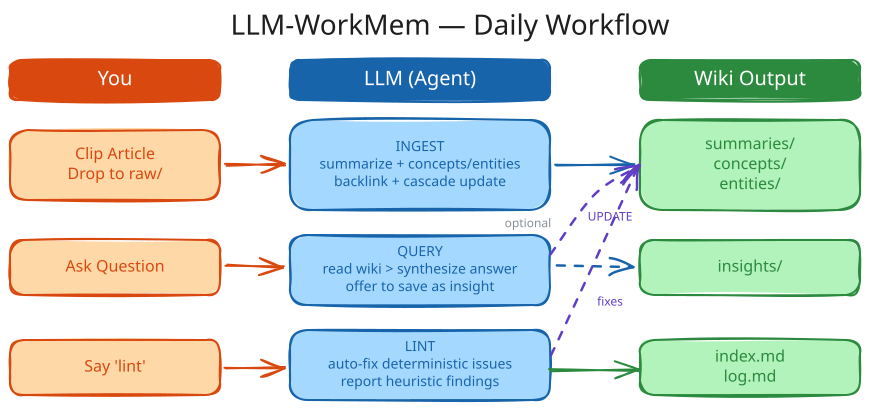

# llm-workmem

<p align="center">
  <br />
  <sub>基于 LLM 的个人知识库</sub>
</p>

一个与你共同成长的 LLM-WorkMem。基于 [Karpathy 的 LLM-WorkMem](https://gist.github.com/karpathy/442a6bf555914893e9891c11519de94f)。

本仓库包含两部分：

| 组件 | 路径 | 用途 |
|------|------|------|
| **Skill** | `skills/llm-workmem/` | Agent 技能（Claude Code / Cursor / Copilot）— INIT、INGEST、QUERY、UPDATE、LINT |
| **CLI** | `lwm/` | Python 命令行工具 — 构建 wiki 目录树并追踪 `raw/` 变更 |

如果你要做更偏“个人知识体”的版本，可以直接用 `lwm init --profile personal`，再用 `lwm analyze` 看图谱里的枢纽、孤立页、断链和缺失来源。`lwm query` 支持 quick / deep / thesis 分层查询，`lwm dashboard` 会生成桌面式 HTML 总览，`lwm serve` 可以启动本地工作台，`lwm harvest` 会把工具记忆体快照进 wiki，`lwm watch` 会在源文件真的变化时才刷新，`lwm export` 会输出 `llms.txt` / `llms-full.txt` / `llms.json`，`lwm adapters` / `lwm attach` 会让 IDE 和 shell 读取这套 wiki，`lwm schedule` 会生成定时运行的 launchd 包。

## Evidence Recall B2

`lwm hub recall` 现在返回项目范围的证据包，而不是只返回页面命中：

```bash
lwm hub recall "当前项目最近完成了什么验证？" \
  --project "/path/to/project" \
  "/path/to/LLM-WorkMem"
```

返回内容会包含 `project_id`、检索计划、证据来源、当前/历史/冲突状态、缺失项和 `coverage`。默认 `compact` 只返回精简证据；明确需要深入查证时使用 `--mode deep --format markdown`。项目无法识别时会明确返回 `global-only`，不会假装是项目记忆。

这个层只组织证据，不替当前 IDE 或 Shell Agent 生成最终答案。回执或 CBMEM 暂时不可用时，读取仍然继续，并在 warning/health 中报告降级状态。

## 跨 Agent 工作流与记忆

全局适配器安装器支持为 Claude Code、Codex、Kiro、Antigravity、MiniMax、OpenCode、Trae、Cursor、Gemini CLI、VS Code 和 Shell 生成各自适用的指令或集成入口。项目级 attach 也会为支持的工具生成项目上下文。Hook 和会话覆盖因宿主而异；仅有指令文件不代表集成已正常工作。

设置仓库路径，预览安装，并检查实际覆盖：

```bash
export LWM_ROOT="/path/to/LLM-WorkMem"
lwm install-global "$LWM_ROOT" --dry-run
lwm hub tools probe --root "$LWM_ROOT" --json
lwm hub coverage --root "$LWM_ROOT" --json
```

LLM-WorkMem 是辅助证据与交接层，不取代各 Agent 原生的指令、技能、计划、执行、验证或记忆；各工具原生工作流仍是权威来源。

> **模型建议：** 由于 wiki 的构建和维护会产生大量 token 消耗，建议使用按计划订阅的服务（如 Claude Max、Cursor 等），或自行部署模型（如 [MiniMax](https://www.minimaxi.com/)、[GLM](https://open.bigmodel.cn/) 等），以避免按量计费带来的高额成本。

## 快速开始

你可以不安装 `uv` 或 `act-cli`，直接手动安装（见下方"手动安装"章节）。

但使用 act 配置文件可以更快地与本仓库同步。

### 1. 前置条件

- 已安装 `uv`，如未安装请参考[安装指南](https://docs.astral.sh/uv/getting-started/installation/)。
- 安装 `act-cli`：

```bash
uv tool install https://github.com/hsuanguo/act-cli.git
```

### 2. 创建 `act.toml`

在你的 wiki 根目录添加 `act.toml`：

```toml
[project]
name = "my-wiki"
description = "My LLM-WorkMem"

[skills]
llm-workmem = "hsuanguo/llm-workmem/skills/llm-workmem"

[dependencies.tools.uv]
lwm = "git+https://github.com/hsuanguo/llm-workmem.git"
```

### 3. 同步

执行：

```bash
act
```

这会安装 `llm-workmem` agent 技能和 `lwm` 命令行工具。

## 手动安装

安装 CLI：

```bash
pip install .
# 或使用 uv：
uv tool install .
```

将技能复制到你的 wiki 中：

```bash
cp -r skills/llm-workmem /path/to/project/.claude/skills/
```

## Skill（技能）

`skills/llm-workmem/` 目录是一个独立的 agent 技能，包含：

- **`SKILL.md`** — 主指令文件（收集上下文、路由操作、执行任务）
- **`references/`** — 各操作的详细手册：`init.md`、`ingest.md`、`query.md`、`update.md`、`lint.md`、`harvest.md`、`watch.md`、`export.md`、`schedule.md`
- **`templates/`** — 初始页面模板：`index.md`、`concept.md`、`entity.md`、`insight.md`、`summary.md`

兼容任何从 `.claude/skills/` 或类似路径读取 `SKILL.md` 的 agent。

`.claude/skills/` 被大多数 AI agent 支持（OpenCode、Cursor 等）。如果你的 agent 不支持此路径，请将其移动到 agent 能识别的位置。

## 使用方法

本技能为 Obsidian 设计，但可搭配任何前端使用。典型工作流如下：

<p align="center">
  <br />
</p>

### 1. 创建新 Wiki（INIT）

告诉 Agent：

```
在 wiki/greek-history 初始化一个关于希腊历史的 wiki
```

AI Agent 会：
- 运行 `lwm init` 创建目录结构
- 生成 `AGENTS.md`（领域模式定义）、`CLAUDE.md` 和初始 wiki 文件
- 创建空的 `raw/`、`assets/` 及 wiki 子目录

**结果：**
```
wiki/greek-history/
├── AGENTS.md           # 领域模式定义
├── CLAUDE.md           # 自动引入 AGENTS.md
├── assets/
├── raw/
│   └── files.log
└── wiki/
    ├── index.md
    ├── log.md
    ├── purpose.md
    ├── overview.md
    ├── summaries/
    ├── concepts/
    ├── entities/
    └── insights/
```

### 2. 添加资料来源（INGEST）

#### 方式 A：文件

将源文件（PDF、Markdown 等）移入 `wiki/greek-history/raw/`

然后告诉 AI：
```
收录 raw/ 中的所有新资料
```

#### 方式 B：直接粘贴内容

```
将以下内容添加到 wiki：
<粘贴文章文本或 URL>
```

#### 收录过程

AI 会：
1. 完整阅读每个资料来源
2. 在 `summaries/`、`concepts/`、`entities/` 中创建或更新页面
3. 执行反向链接审查 — 在现有页面间添加 `[[wikilinks]]`
4. 扫描整个 wiki，查找受新信息影响的页面（级联更新）
5. 更新 `index.md`、`overview.md` 和 `log.md`
6. 通过 `lwm raw sync` 同步 `raw/files.log`

**注意：** AI Agent 会自主执行全部流程，只在遇到真正模糊的情况（事实不明、来源冲突且无法自行判断）时才会向你确认。

### 3. 提问（QUERY）

```
关于伯罗奔尼撒战争我们了解多少？
```

```
对比所有资料中雅典和斯巴达的军事策略
```

```
关于迈锡尼文明的衰落，还有哪些未解之谜？
```

AI 严格基于 wiki 内容回答，使用 `[[wikilinks]]` 引用页面。回答后，它可能会：
- **主动提议保存**分析结果为 insight 页面（如果回答有独立价值）
- **报告问题** — 发现现有页面中的过时信息或矛盾，并询问是否需要修复

### 4. 更新页面（UPDATE）

#### 用户触发（你主动要求修改）

```
更新 concepts/democracy.md — 最新资料说 X
```

```
修复 concepts/oligarchy.md 和 concepts/democracy.md 之间的矛盾
```

Agent 会为每个页面展示差异对比，等待你确认后再写入。

#### LLM 触发（收录过程中自动更新）

当新资料影响已有页面时，如果改动明确，AI Agent 会自动更新。只有在不确定或涉及含义变更时才会征询你的意见。

### 5. 健康检查（LINT）

```
检查 wiki
```

AI 会检查：

| 类别 | 自动修复？ | 示例 |
|------|-----------|------|
| **确定性问题** | 是 | 断链、缺失 frontmatter、索引不一致 |
| **启发性问题** | 否 — 仅报告 | 矛盾、过时声明、孤立页面、缺失交叉引用、过时 insight |

将检查报告写入 `insights/lint-<date>.md`，并为启发性问题提供修复建议。

### 6. 检查新资料（漂移检测）

```
raw/ 里有新文件吗？
```

或直接运行：

```bash
lwm raw status    # 仅报告
lwm raw sync      # 更新 files.log
```

## 日常工作流

| 你做的 | AI 做的 |
|--------|---------|
| 剪藏文章 → 放入 `raw/` | 收录、摘要、交叉引用 |
| 提问 | 基于 wiki 回答，主动保存 insight |
| 偶尔说"检查一下" | 健康检查、修复问题、发现空白 |
| 审阅和引导 | 其他一切 |

## 多 Wiki 设置

你可以在一个 vault 下管理多个 wiki：

```
vault/wiki/
├── greek-history/   # 一个知识库
├── health/          # 另一个
└── reading/         # 再一个
```

每个 wiki 完全独立，拥有自己的 `AGENTS.md` 模式定义。Agent 会根据你所在的目录自动加载对应的模式。

## 小贴士

- **Obsidian Web Clipper** 是将文章放入 `raw/` 的最快方式
- Obsidian 中的**图谱视图**可展示 wiki 结构 — 枢纽、孤立节点、集群
- **Dataview** 插件可按类型、标签或日期查询页面
- 你永远不需要自己写 wiki 页面 — AI 会处理所有维护工作
- `lwm dashboard` 会生成一个可直接打开的桌面式 HTML 页面
- `lwm query` 会在 wiki 页面里做分层查询和综合输出
- `lwm serve` 会把整个 wiki 启动成一个本地工作区
- `lwm harvest` 会把工具记忆体快照并刷新 wiki
- `lwm watch` 会在源文件有漂移时才刷新并审计结果
- `lwm export` 会输出可供其他 agent 直接消费的 `llms.txt`、`llms-full.txt` 和 `llms.json`
- `lwm schedule` 会生成定时 watch + audit 的 launchd 包

### Loop Engineering 控制状态

定时工作按一个有边界的循环运行：感知、定义、分解、执行、评估、更新。
每轮都会把预期结果、实际证据、下一动作和退出状态写入
`state/active-loop.json` 或 `state/last-loop.json`。只有存在外部证据时，
才能进入 `completed_verified`；仅有适配器文件或 launchd plist 不代表完成。

运行 `lwm hub closure <root>` 查看收口门。它会检查循环状态、证据文件、
源代码与运行副本可读性、导出文件、回执、严格健康状态和 launchd。缺少
证据会明确报告为 `degraded` 或 `blocked`。

## 代码库记忆（`lwm cbmem`）

`lwm cbmem` 封装了 [DeusData/codebase-memory-mcp](https://github.com/DeusData/codebase-memory-mcp)，让 wiki 能对任意项目目录回答代码结构问题。封装在 `lwm/cbmem.py`；决策记录在 [wiki/insights/integrations-2026-06-30.md](wiki/insights/integrations-2026-06-30.md)；速查表在 [wiki/summaries/lwm-cbmem-cheatsheet.md](wiki/summaries/lwm-cbmem-cheatsheet.md)。

一次性安装（下载约 270 MB 到 `~/bin/`）：

```bash
bash automation/install-cbmem.sh
lwm cbmem doctor
```

子命令：`doctor`、`index`、`index-status`、`search`、`architecture`、`trace`、`changes`、`dead`、`query`、`semantic`。完整列表见 `lwm cbmem --help`。

> **关于 macOS 沙箱。** 一些 agent 沙箱（特别是 Claude Code 的 Bash）会以退出码 137 SIGKILL 掉这 270 MB 的二进制。请在真实终端中运行 `lwm cbmem *`，而不要在沙箱中运行。完整原因见 [wiki/insights/integrations-2026-06-30.md](wiki/insights/integrations-2026-06-30.md) 决策 1。

## 许可证

[MIT](LICENSE)
